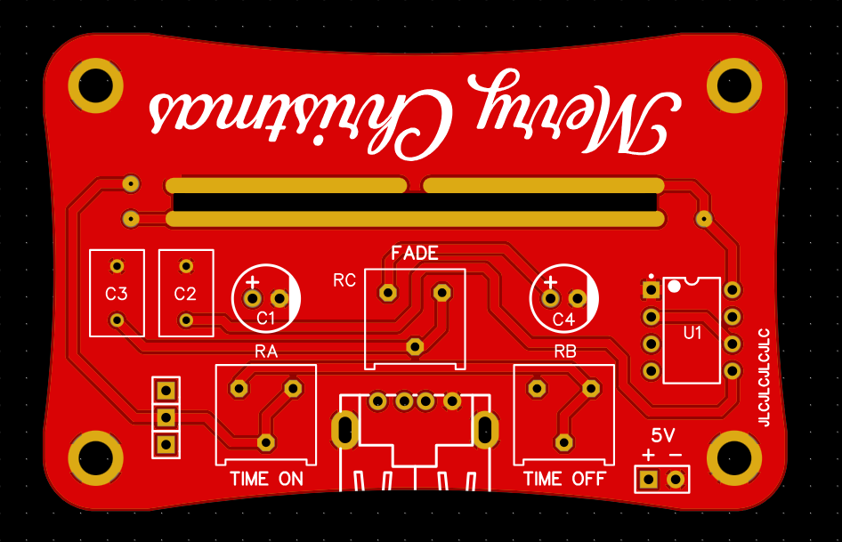
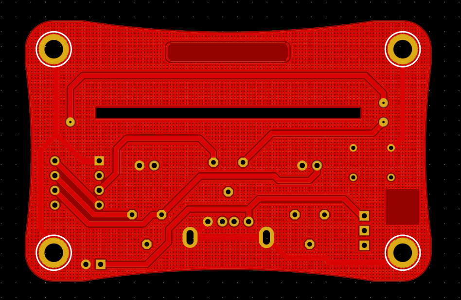
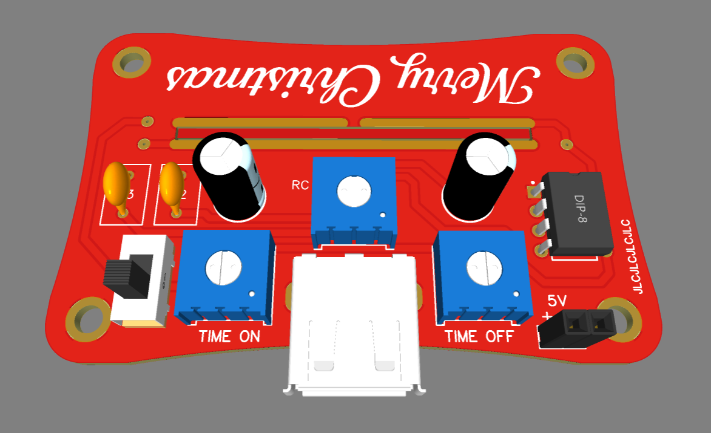
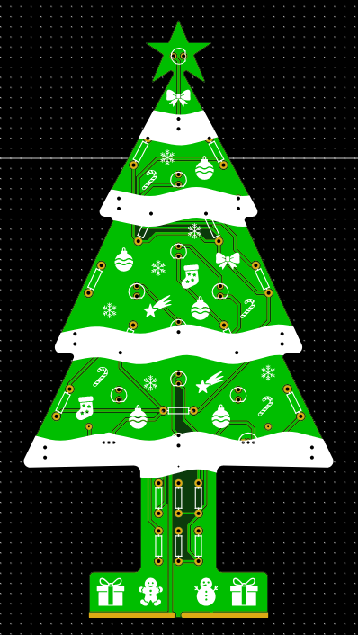
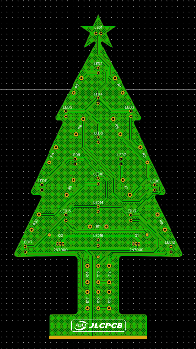
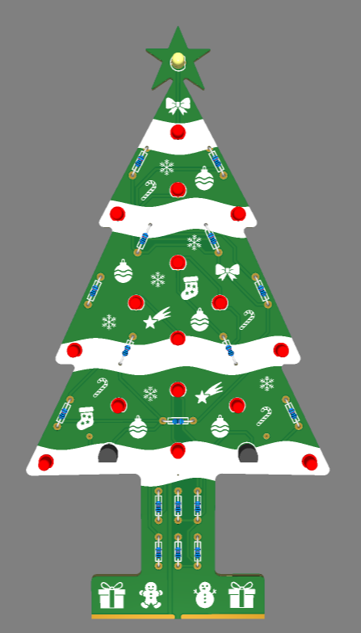
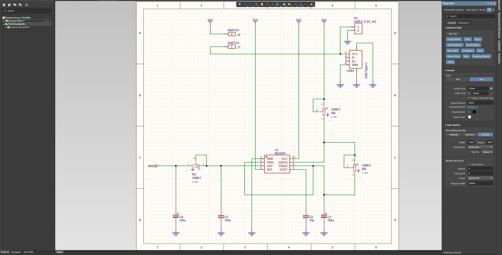
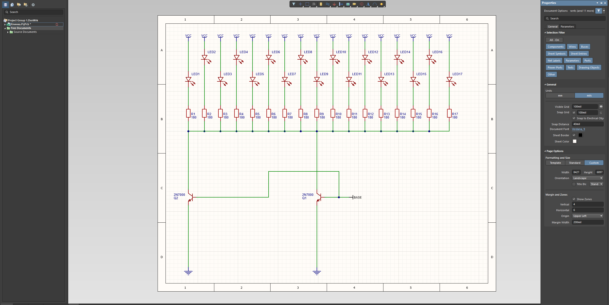

<h1 align="center">🎄 Різдвяна LED-ялинка (XmasTree)</h1>

  Декоративна ялинка з друкованих плат із плавним мерехтінням світлодіодів.

## 🌟 Про проєкт

**XmasTree** — невелика електронна новорічна прикраса у формі ялинки. Її основа та верхня частина виготовляються як окремі друковані плати, які після складання з'єднуються між собою.

На ялинці розміщено **17 світлодіодів**. Вони поступово збільшують і зменшують яскравість, створюючи ефект плавного згасання та засвічування (*fade in / fade out*). Для керування використано таймер **NE555** і транзистори **2N7000**. Живлення подається через **USB (5 В)**.

Схеми та плати розроблено в **EasyEDA**. Конструкція розрахована на монтаж вивідних компонентів (PTH), тому її зручно збирати вручну.

## ⚙️ Особливості

- **17 світлодіодів** із плавною зміною яскравості.
- Генератор сигналу на основі **NE555** та MOSFET-транзисторів **2N7000**.
- Живлення від **USB 5 В**.
- Налаштування плавності світлового ефекту підлаштувальним резистором **RC**.
- Регулювання частоти роботи за допомогою **RA** та **RB**.
- Окремий вимикач живлення.
- Дві друковані плати: **підставка з електронікою** та **ялинка зі світлодіодами**.

## 🔌 Будова

**Плата-підставка** містить таймер, транзистори, регулювальні елементи, вимикач і USB-роз'єм. Вона відповідає за живлення та керування світловим ефектом.

**Плата-ялинка** має форму новорічного дерева. На ній розташовані світлодіоди та резистори. Плата встановлюється у проріз підставки й припаюється до неї.

## 🖼️ Зображення плат

Наведені нижче ілюстрації показують проєкт плат у редакторі EasyEDA, зокрема їхні шари та 3D-моделі.

### Плата-підставка

  

<em>Рис. 1 — Верхній шар плати-підставки</em>

  

<em>Рис. 2 — Шари плати-підставки</em>

  

<em>Рис. 3 — 3D-модель плати-підставки</em>

### Плата-ялинка

  

<em>Рис. 4 — Верхній шар плати-ялинки</em>

  

<em>Рис. 5 — Нижній шар плати-ялинки</em>

  

<em>Рис. 6 — 3D-модель плати-ялинки</em>

## 📐 Електричні схеми

Схеми показують з'єднання елементів на обох платах: світлодіодів, резисторів, таймера NE555, транзисторів, регуляторів та ліній живлення.

  

<em>Рис. 7 — Схема плати-ялинки</em>

  

<em>Рис. 8 — Схема плати-підставки</em>

## 🛠️ Складання

1. Встановіть і припаяйте компоненти на платі-підставці відповідно до позначень на ній.
2. Припаяйте світлодіоди й резистори до плати-ялинки, дотримуючись полярності світлодіодів.
3. Вставте ялинку у проріз підставки та припаяйте контактні з'єднання.
4. Перевірте правильність монтажу й відсутність коротких замикань.
5. Під'єднайте живлення **USB 5 В**, увімкніть пристрій та налаштуйте характер світіння регуляторами.

> **Порада:** зручніше починати паяння з найнижчих компонентів, поступово переходячи до вищих.
